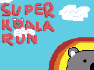

# Super Koala Run

This is a game I'm working on for week 4 of Terra.

## How to run
It can be accessed on web at https://laundromatcat.itch.io/super-koala-run.

## What's it about?

This is based on a platformer game that my friend made a few years back, remade from makecode arcade to Godot. I want to improve the quality of the assets, art and gameplay, and eventually after the basics are done add my own twist. 

So far, I've gotten some of the basics down, with the movement, enemies, and basic levels. 

There are two enemies so far: the "snake" (which is currently a godot logo) and the spiked turtle, which is a more dangerous version of the snake.

